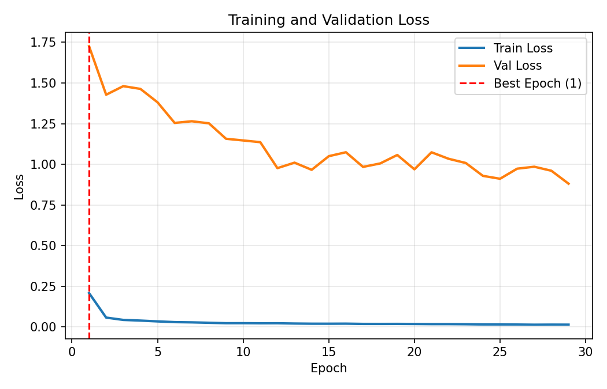
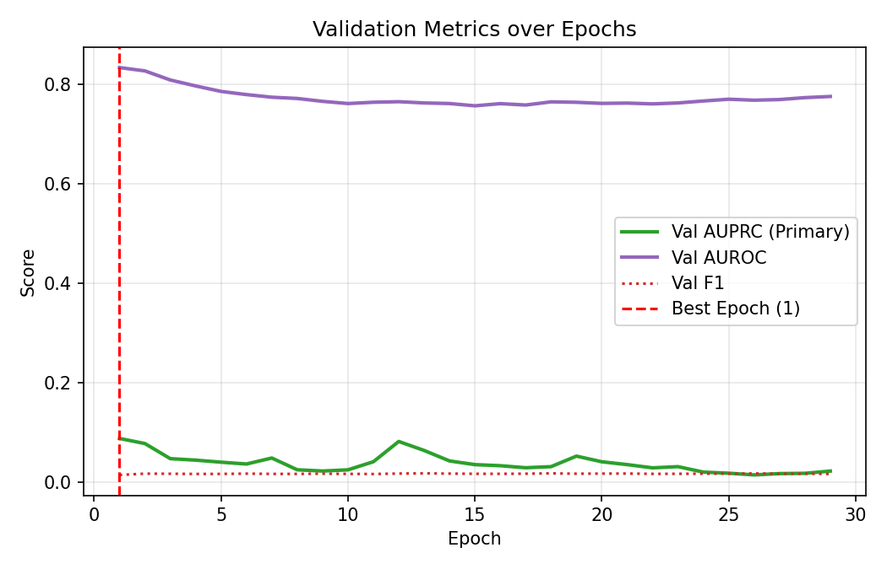
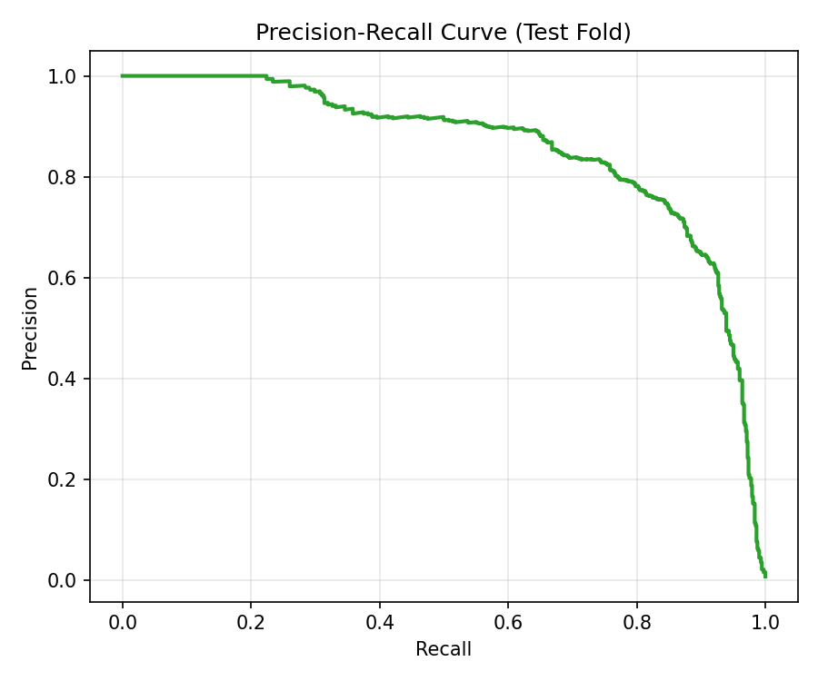
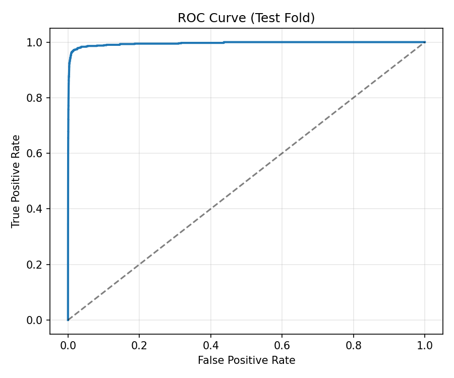
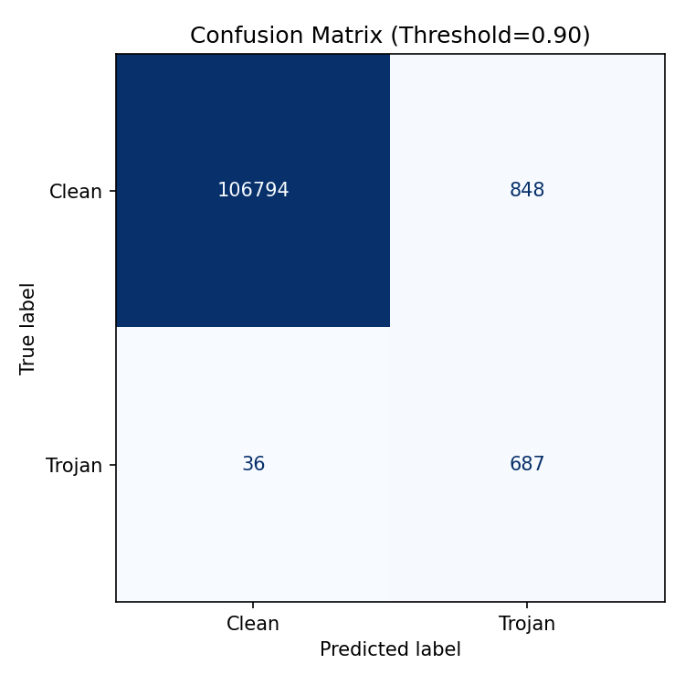

# Training Report: gcn_seed7

## 1. Executive Summary
- **Model Architecture**: gcn
- **Outer Test Fold**: c2670
- **Seed**: 7
- **Training Wall Time**: 780.7 seconds
- **Parameters Count**: 6,534
- **Early Stopping**: Triggered at epoch 29 (Best weights restored from **Epoch 1**)

---

## 2. Test Fold Detection Results
- **Node AUROC**: 0.9954
- **Node AUPRC (Primary Metric)**: 0.8572
- **Top-10 Precision**: 1.0000
- **Top-10 Recall**: 0.0138
- **Decision Threshold (calibrated on Val)**: 0.900
- **F1 Score**: 0.6085
- **Brier Score**: 0.0164
- **ECE (Calibration Error)**: 0.0268
- **Graph-level AUROC**: 1.0000

---

## 3. Training Diagnostic Interpretation
- **Generalization Gap**: Best validation AUPRC was 0.0878 compared to test AUPRC of 0.8572.
- **Convergence Behavior**: Early stopping successfully halted training before overfitting to the training families.
- **Inductive Generalization**: The model successfully detects hardware Trojans on the unseen **c2670** circuit family without observing any related variants during training.

---

## 4. Training Visualizations

